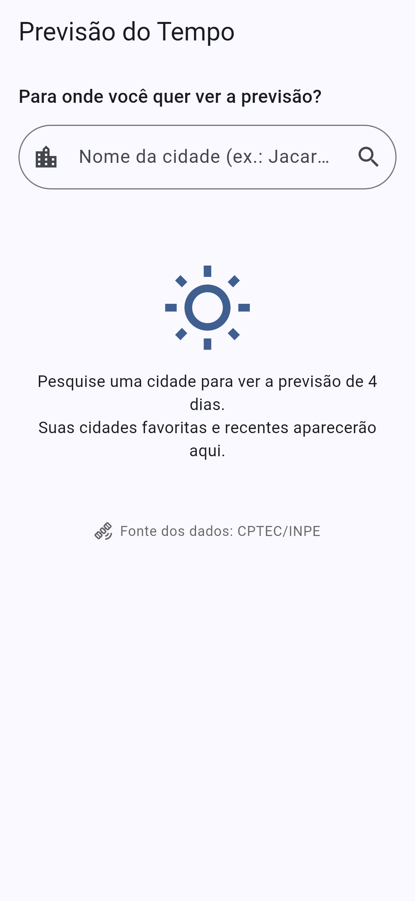
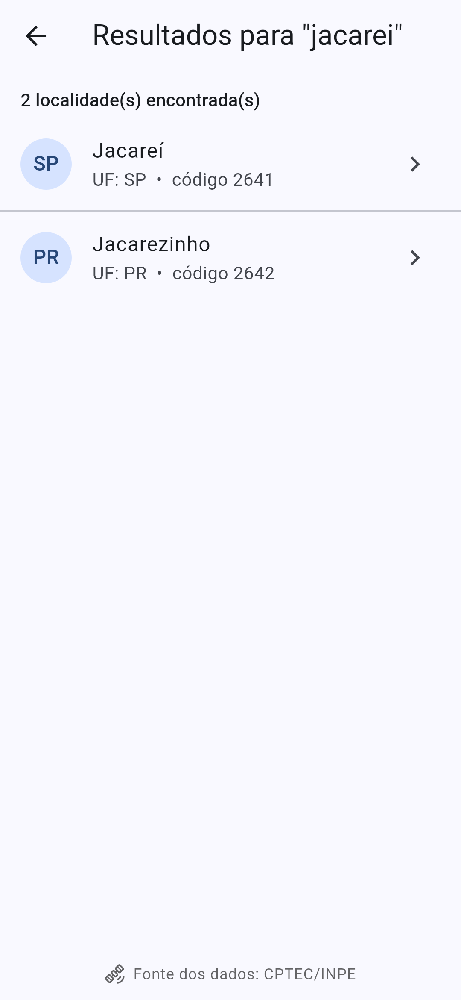
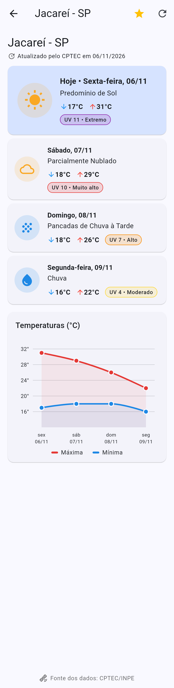
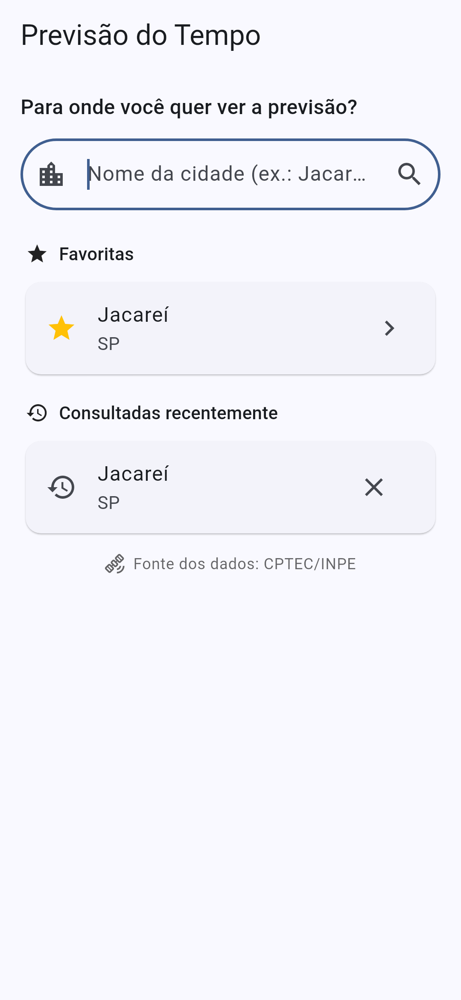
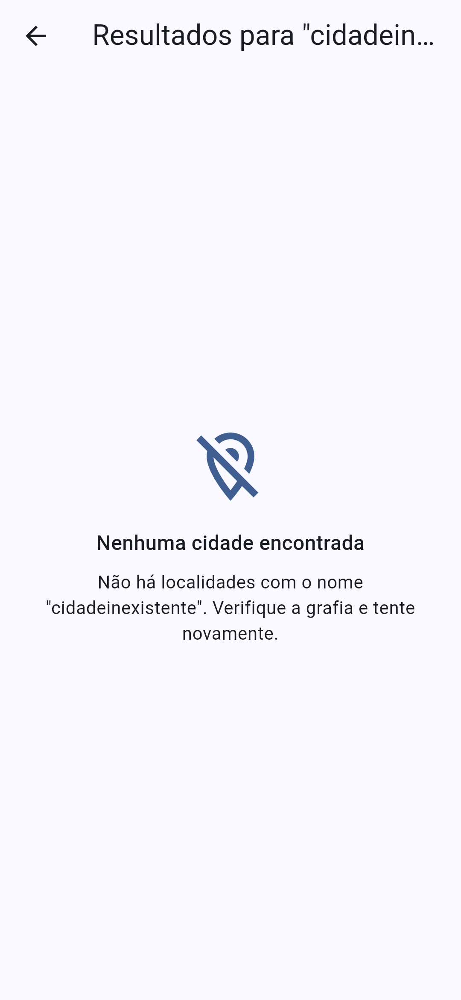
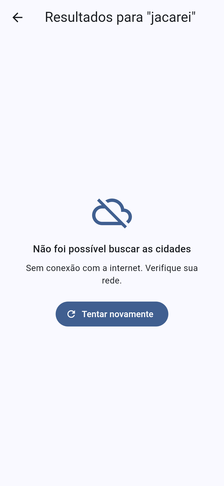

# 🌦️ Previsão do Tempo — CPTEC/INPE

Aplicativo Flutter para consultar a previsão do tempo de cidades brasileiras usando o serviço XML do **CPTEC/INPE**: pesquisa de cidades, previsão de 4 dias e gráfico de temperaturas.

> **Atividade 2 – Previsão do tempo** — Programação para Dispositivos Móveis II (Prof. Arley)
> FATEC Jacareí — Desenvolvimento de Software Multiplataforma
> Aluno: André Luis Alves Ramos Junior

---

## ✅ Funcionalidades implementadas

**Pesquisa de cidades**
- Campo de busca pelo nome da cidade (acentos são removidos antes da consulta, pois o serviço não os aceita — ex.: "Jacareí" → `jacarei`).
- Resultados com **nome da cidade e UF** (e o código da localidade); o usuário toca na localidade desejada.
- O código usado na previsão é o **`id` retornado pelo próprio serviço**.

**Previsão do tempo (4 dias)**
- Exibe **todos os dias retornados**, cada um com: data, **mínima e máxima em °C**, **descrição da condição** (sigla convertida conforme a tabela oficial do CPTEC — as 40 siglas), **ícone representativo** e **índice ultravioleta** (quando disponível), com classificação Baixo/Moderado/Alto/Muito alto/Extremo.
- Mostra a **data de atualização informada pelo serviço**.
- **Gráfico de linhas** com as temperaturas máxima e mínima dos dias (fl_chart).

**Atualização e tratamento de erros**
- Botão **Atualizar** na barra superior e *pull-to-refresh*.
- **Indicador de carregamento** em todas as consultas.
- Mensagem **"Nenhuma cidade encontrada"** quando a busca não retorna localidades.
- Tratamento de **falha de conexão**, **tempo esgotado**, **serviço indisponível** (HTTP 5xx/404) e **respostas inválidas** (XML malformado ou com raiz inesperada), sempre com botão "Tentar novamente".
- Mensagem **"Previsão indisponível"** quando o serviço não tem dados para a localidade.
- **Campos ausentes** (`iuv`, `maxima`, `tempo`, `atualizacao`…) são tratados como opcionais — o app mostra `--` ou omite a informação, sem encerrar.
- **CPTEC/INPE identificado como fonte dos dados** no rodapé fixo da tela de previsão e nas demais telas.

**Extras**
- Cidades **favoritas** (estrela na tela de previsão) e **consultadas recentemente** na tela inicial.
- **Modo offline**: se a consulta falhar por rede, o app mostra a última previsão salva daquela cidade, com aviso e a data em que foi obtida.

---

## ▶️ Instruções para executar

Pré-requisitos: [Flutter](https://docs.flutter.dev/get-started/install) 3.x (testado com Flutter 3.47 / Dart 3.13) e emulador Android/iOS ou dispositivo físico com internet.

```bash
git clone <url-do-repositorio>
cd previsao_tempo
flutter pub get
flutter run
```

Testes automatizados (parser XML, serviço com respostas simuladas, cache e fluxo das telas):

```bash
flutter test
```

> **HTTP sem TLS:** o serviço do CPTEC responde em `http://`. Por isso o Android usa um
> `network_security_config.xml` liberando *apenas* o domínio `servicos.cptec.inpe.br`, e o iOS tem uma
> exceção de ATS para o mesmo domínio. A permissão `INTERNET` está declarada no `AndroidManifest.xml`.

---

## 🌐 Serviço utilizado

[Serviço XML do CPTEC/INPE](http://servicos.cptec.inpe.br/XML/) (respostas em ISO-8859-1):

| Uso | Endpoint |
|---|---|
| Buscar localidades | `GET http://servicos.cptec.inpe.br/XML/listaCidades?city={nome}` → `<cidades><cidade><nome/><uf/><id/></cidade>…` |
| Previsão de 4 dias | `GET http://servicos.cptec.inpe.br/XML/cidade/{codigo}/previsao.xml` → `<cidade><nome/><uf/><atualizacao/><previsao><dia/><tempo/><maxima/><minima/><iuv/></previsao>…` |

## 📦 Bibliotecas utilizadas

| Pacote | Uso |
|---|---|
| [`http`](https://pub.dev/packages/http) | Requisições HTTP ao CPTEC |
| [`xml`](https://pub.dev/packages/xml) | Interpretação das respostas XML |
| [`shared_preferences`](https://pub.dev/packages/shared_preferences) | Persistência local |
| [`fl_chart`](https://pub.dev/packages/fl_chart) | Gráfico de temperaturas |
| [`intl`](https://pub.dev/packages/intl) | Datas em pt-BR |
| `flutter_localizations` (SDK) | Localização pt-BR |
| `shared_preferences_platform_interface` (dev) | Armazenamento em memória nos testes |

## 💾 Estratégia de persistência local

Usa **`shared_preferences`** (API `SharedPreferencesAsync`), adequada a dados pequenos de chave-valor, com valores serializados em JSON:

| Chave | Conteúdo |
|---|---|
| `cidades_recentes` | Lista JSON das últimas 8 cidades consultadas (`id`, `nome`, `uf`), da mais recente para a mais antiga. |
| `cidades_favoritas` | Lista JSON das cidades favoritas, em ordem alfabética. |
| `previsao_cache_<codigo>` | `{ "xml": "...", "consultadoEm": "ISO-8601" }` com a **última resposta XML válida** de cada cidade. |

Fluxo (`PrevisaoRepository`): toda consulta bem-sucedida grava o XML bruto no cache. Se uma consulta seguinte falhar por conexão/serviço, o repositório lê o cache, interpreta o XML novamente e devolve a previsão marcada como **offline**. Guardar o XML original (e não um objeto já convertido) mantém um único caminho de interpretação. Dados corrompidos no armazenamento são ignorados sem derrubar o app.

## 🗂️ Estrutura do código

```
lib/
├── main.dart                        # App, tema, localização e RepositorioScope
├── models/                          # Cidade, Previsao, PrevisaoDia, ResultadoPrevisao
├── services/
│   ├── cptec_service.dart           # Requisições HTTP + tratamento de falhas
│   └── cptec_parser.dart            # Parser XML (encoding, campos ausentes, validação)
├── data/
│   ├── armazenamento_local.dart     # shared_preferences (recentes, favoritas, cache)
│   └── previsao_repository.dart     # Rede + fallback para cache
├── utils/condicoes_tempo.dart       # Siglas → descrição/ícone/cor, classificação UV
├── screens/                         # Início, resultados da busca, previsão
└── widgets/                         # Card do dia, gráfico, estados (carregando/erro), fonte
```

---

## 🖼️ Capturas de tela

| Início | Resultados da busca | Previsão de 4 dias + gráfico |
|---|---|---|
|  |  |  |

| Favoritas e recentes | Nenhuma cidade encontrada | Sem conexão |
|---|---|---|
|  |  |  |

> As capturas foram geradas com respostas XML de exemplo pelo script `docs/gerar_capturas_test.dart`
> (`flutter test docs/gerar_capturas_test.dart --update-goldens`).

Dados meteorológicos: **CPTEC/INPE** — Centro de Previsão de Tempo e Estudos Climáticos / Instituto Nacional de Pesquisas Espaciais.
